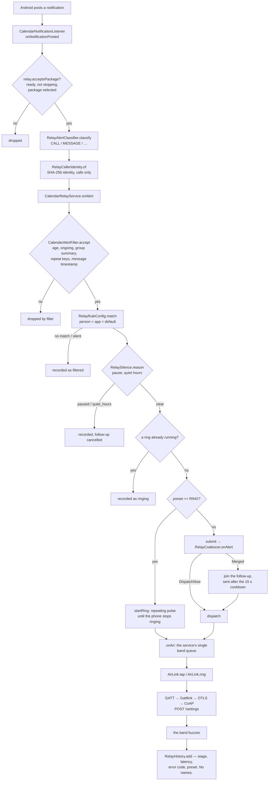

# Cuff — technical design

Written 6 November 2026, against branch `native`. This document is for an
Android engineer who has never seen the repository and wants to understand how
it works end to end before changing any of it.

It describes what the code does, not what it ought to do. Where something could
not be established from the source it says so rather than guessing; those
places are marked **Not established**. The companion documents are
[`HANDOVER.md`](HANDOVER.md), which is the living record of decisions and
traps, [`ROADMAP.md`](ROADMAP.md), and the research in
[`explorations/`](explorations/).

## Contents

- [Purpose and constraints](#purpose-and-constraints)
- [Tech stack](#tech-stack)
- [Module structure](#module-structure)
- [The relay path, end to end](#the-relay-path-end-to-end)
- [The BLE and device protocol layer](#the-ble-and-device-protocol-layer)
- [How Health Connect data gets in](#how-health-connect-data-gets-in)
- [Derived metrics](#derived-metrics)
- [UI architecture](#ui-architecture)
- [Widgets](#widgets)
- [Background work](#background-work)
- [Persistence](#persistence)
- [Threading and performance](#threading-and-performance)
- [Testing strategy](#testing-strategy)
- [Security and privacy posture](#security-and-privacy-posture)
- [Known limitations and failure modes](#known-limitations-and-failure-modes)

## Purpose and constraints

The Fitbit Air is a screenless fitness band. It has a vibration motor, a status
light, a heart rate sensor and a step counter, and it syncs to Google Health
over Bluetooth Low Energy. What it does not have is any notification support:
the motor fires for alarms and Smart Wake, and Fitbit's own app offers no way
to make it fire for anything else.

This app makes it fire anyway, and reads the band's own measurements back out
of Health Connect so there is something to look at as well as something to
feel. Three constraints shape every decision in the codebase.

**The band has no vibrate command.** It has a vibration-*strength* setting, and
it buzzes once when that setting changes. Every haptic in this app is therefore
a write to the band's `/settings` CoAP resource — see
[the protocol layer](#the-ble-and-device-protocol-layer). Patterns are counts
and cadence, never waveforms.

**The band grants one secure session at a time.** A session is a BLE connect, a
Gattlink handshake and a DTLS handshake, and it costs 2.5–3.7 seconds before
the first byte of payload lands. Google Health wants that same session to sync
your steps. Everything in the app that touches the band is serialised behind a
single queue for this reason, and the whole coalescing design exists to keep the
channel free.

**Two things the hardware will not do, established by probing rather than
assumed.** The status light has no CoAP resource — light-shaped paths answer
`4.04` where resources that exist behind Google Health's credentials answer
`4.01` — so alerts cannot be colour-coded. And wrist taps are handled in
firmware and produce no upstream traffic, so tap-to-silence is impossible.
Both are recorded in the owner's protocol notes rather than in this repository.

The protocol itself is reverse-engineered and version-sensitive. A firmware
update or a Google Health update can break the relay without warning, which is
why the repository carries a firmware issue template and why the app keeps a
local crash log.

## Tech stack

There is **no Gradle version catalog** in this repository: `gradle/` holds only
the wrapper, and every dependency is declared literally in the module build
files. The versions below are read from `build.gradle.kts`,
`app/build.gradle.kts`, `air/build.gradle.kts` and
`baselineprofile/build.gradle.kts`.

| Piece | Version | Where |
| --- | --- | --- |
| Android Gradle Plugin | 8.11.1 | root `build.gradle.kts` |
| Kotlin (`org.jetbrains.kotlin.android`) | 2.2.20 | root |
| Compose compiler plugin | 2.2.20 | root |
| Baseline Profile plugin | 1.4.1 | root |
| `compileSdk` / `targetSdk` | 36 | `app`, `air`, `baselineprofile` |
| `minSdk` | 28 | `app`, `air` |
| Java / JVM target | 17 | all modules |
| Compose BOM | `2024.09.00` | `app` |
| Material 3 | from the BOM | `app` |
| Navigation Compose | 2.8.1 | `app` |
| Lifecycle (runtime, compose, viewmodel, service) | 2.8.6 | `app` |
| Activity Compose | 1.9.2 | `app` |
| `core-ktx` | 1.13.1 | `app` |
| DataStore Preferences | 1.1.1 | `app` |
| WorkManager | 2.9.1 | `app` |
| Health Connect client | 1.1.0 | `app` |
| Glance (appwidget, material3) | 1.1.1 | `app` |
| RxJava 2 / RxAndroid | 2.2.21 / 2.1.1 | `air` |
| OkHttp | 4.12.0 | `air` |
| Timber | 4.7.1 | `air` |
| JUnit 4 | 4.13.2 | `app` tests |
| `org.json` | 20240303 | `app` tests, for the JSON config decoder |
| JUnit 5 + Mockito | 5.11.4 / 5.0.0 | `air` tests |
| Macrobenchmark, UiAutomator, Espresso | 1.4.1 / 2.3.0 / 3.6.1 | `baselineprofile` |

Two notes on the choices. `connect-client` is pinned at **1.1.0, not the 1.2
alphas**: those demand AGP 9 and `compileSdk` 37, and 1.1.0 already carries the
background-read permission and the feature-availability check. And DataStore is
a declared dependency, but the app's own state is in fact stored in
`SharedPreferences` — see [Persistence](#persistence), which is honest about
the gap.

Concurrency is coroutines and Flow in `:app` (`CoroutineScope`, `StateFlow`,
`Dispatchers.IO` for reads) and RxJava 2 in `:air`, because the vendored
Golden Gate bindings are Rx throughout and converting them was not worth the
churn. The seam between the two is `AirLink`'s callback interfaces, `AirResult`
and `AirSink`.

The app ships `arm64-v8a` only (`ndk { abiFilters += "arm64-v8a" }`), because
that is the one ABI anyone has verified the transport on.

## Module structure

```
air-bridge/
├── app/              the application: UI, relay, Health, widgets  (~37k lines Kotlin)
├── air/              the Fitbit Air transport, vendored           (~139 Kotlin files + 6 .so)
└── baselineprofile/  a com.android.test module that records a startup profile
```

### `:app`

Namespace `com.srineere.airbridge`, `applicationId` `com.srineere.cuff`, with
debug installing as `com.srineere.cuff.dev` so it sits beside a release build
rather than over it. Source lives under `app/src/main/kotlin/com/srineere/airbridge/`
in four groups:

- the package root — the relay: the listener, the foreground service, the rule
  engine, the config store, the activity history, the crash log;
- `health/` — everything Health Connect, plus the derived metrics and their
  stores;
- `ui/` — Compose screens, the navigation graph, charts, theming;
- `widget/` — Glance widgets, the stack provider, bitmap renderers, the
  catalogue.

### `:air`

Namespace `dev.airpulse.fitbit_air`. Two halves:

- `com/fitbit/goldengate/bindings/**` — the Golden Gate Kotlin bindings,
  vendored from Thore Koritzius' `fitbit_air` plugin, which in turn derives
  them from Fitbit's own open-source stack. These bind to the prebuilt native
  libraries **by JNI symbol name**, so the package names can never be renamed.
  They are marked `linguist-vendored` in `.gitattributes`.
- `dev/airpulse/fitbit_air/**` — the app-facing layer: `AirLink` (1,625 lines,
  the whole protocol state machine), the battery decoder, the channel monitors,
  the warm-link cache, the transport lease.

**Why it is vendored rather than a dependency.** The project began as the
example relay inside that upstream plugin, which was Flutter. The November 2026
rewrite to native Kotlin and Compose meant the transport had to exist as an
Android library rather than as a Flutter plugin, and the held-session ring and
the settings/resource probing developed here diverged from upstream. The
licensing arrangement is set out in
[`THIRD_PARTY_NOTICES.md`](../THIRD_PARTY_NOTICES.md).

**The prebuilt `.so` files.** `air/src/main/jniLibs/` carries `libgg.so` and
`libxp.so` for three ABIs — `arm64-v8a`, `armeabi-v7a`, `x86_64` — six files in
all. `libgg.so` is Golden Gate itself with Mbed TLS 2.28.10 and lwIP statically
linked into it; `libxp.so` is its cross-platform support library. They are
built from upstream source at commit `b8a6f255…` without modification, and no
NDK step exists in this repository: CI compiles Kotlin against them and never
rebuilds them.

**Not established.** The CI workflow's comment says "`tool/native/build.py`
reproduces them", but **no `tool/` directory exists in this repository** and no
`build.py` is checked in anywhere. `THIRD_PARTY_NOTICES.md` is the accurate
statement: "the build script that produced them is upstream's, not in this
repository." The CI comment should be read as stale.

### `:baselineprofile`

A `com.android.test` module targeting `:app`. It installs the app on a connected
device, drives a cold start and two scrolls of the Health tab, and records which
classes and methods that path touches. Nothing from this module ships. What
ships is the text it writes, committed at
`app/src/release/generated/baselineProfiles/baseline-prof.txt` and
`startup-prof.txt`, which `profileinstaller` hands to the runtime on first
launch so the hot path is compiled ahead of time rather than interpreted.

It uses `useConnectedDevices = true` rather than a managed device, and it
refuses to record when the Health tab is showing its "Allow Health Connect"
card — see [Testing strategy](#testing-strategy) for why that guard exists.

## The relay path, end to end



### The hops, by class

**`CalendarNotificationListener`** (a `NotificationListenerService`, declared
with `BIND_NOTIFICATION_LISTENER_SERVICE`) is the only entry point for
notifications. It never starts work itself; it hands everything to the service
through `CalendarRelayService.active`, and it logs metadata only — package,
ongoing flag, category, channel — never sender or text. It also owns
`RelayConversations.observe`, which is how per-conversation rules learn what
conversations exist. `onNotificationRemoved` is how a ring learns the call
ended: when the ringing app takes its notification back, the ring stops.

**`RelayAlertClassifier`** (in `RelayAlertKind.kt`) decides whether a
notification is a call or a message, from the notification's category, its
full-screen intent and its ongoing flag. Calls take a different default preset
from messages, and only calls get a caller identity.

**`RelayCallerIdentity`** (in `RelayCallers.kt`) turns a caller into a one-way
SHA-256 hash. A phone number hashes **without** the package, so the same person
is one identity whichever app they ring from; a display name hashes **with** it,
because a name only means something inside one app. This is why a contact can
hold two rules — the dialer's and WhatsApp's — and why the People screen merges
them into one row.

**`RelayContacts`** reads the contact list, only when a caller list is opened,
and turns numbers into the same hashed identity a call arrives with. Apps that
name their callers are listed in `RelayContacts.NAMED_CALLERS` (WhatsApp and
WhatsApp Business, Telegram and Telegram Web); any other app earns the same
treatment automatically the first time it names someone, through
`RelayAppSelection.rememberNamesCallers`.

**`CalendarAlertFilter`** is the cheap, stateful gate: notification age, ongoing
and group-summary flags, repeat keys, and the latest message timestamp parsed
out of `Notification.MessagingStyle` (Android 11 and up only; older devices fall
back to conservative once-per-notification behaviour).

**`RelayRulePolicy.kt`** holds the rule engine. `RelayRuleConfig.match()`
resolves most-specific-wins:

```
a person's own rule  →  the app's own rule  →  the matching default
```

There are four defaults: `defaultPreset` (how apps buzz), `defaultCallPreset`
(how the phone rings), `defaultAppCallPreset` (how an app rings), and the shared
ring cadence. Which call default applies depends on whether the package *is* the
dialer, which is a runtime fact — `match()` takes a `dialer` argument rather
than assuming Google's. A preset is a pattern (`SILENT`, `ONE`, `TWO`, `RING`)
and a strength (the band's two intensities, 2 and 3).

**`RelaySilence`** (same file) is checked before anything else buzzes.
`reason()` returns `"paused"`, `"quiet_hours"` or null. A pause outranks the
quiet window, because a pause is an answer given by hand a few minutes ago and a
window was set months back. One exception exists: `callsStillRing` lets calls
through the quiet window when it is switched on, because not being woken by
messages and not wanting to know the phone is ringing are different wishes.
`nextChange()` tells the service when the answer could change on its own, so the
foreground notification's wording is refreshed at boundaries rather than every
minute. The constructor requires `startMinute != endMinute` when quiet hours are
on, because such a window never ends.

**`RelayConversationPolicy`** decides whether a conversation inside a messaging
app is allowed through, from the app's restricted flag and its allowed identity
set. `RelayConversations` holds the short capture window the picker uses
(listening for 60 s, selectable for 5 minutes after).

**`RelayCoalescer`** is what keeps the band's channel free. The first alert
dispatches immediately; anything arriving while a command runs, or within the
15-second cooldown after it finishes, joins **one** follow-up command sent when
the cooldown ends. A burst of twenty messages therefore costs at most two
sessions, and Google Health gets a window in between to resynchronise.

**`CalendarRelayService`** is the foreground service (`connectedDevice` type)
and the owner of the band link. The rules it enforces:

- `onStartCommand` calls `enterForeground()` **first, before any bail-out**.
  `stopSelf()` does not excuse you; Android kills a process that has not
  foregrounded within five seconds.
- `onAir { }` is the single queue; `airBusy` plus `airQueue` serialise every
  command, including a live heart rate measurement, so a message pulse waits
  rather than failing `BUSY`.
- `holdsBand` exists because the service object outlives its link — it is alive
  while starting, and ColorOS revives it after a force stop — so "service alive"
  and "band taken" are different questions.
- `requestStop` carries a human reason, which the UI surfaces.
- A ring runs in a `RingSession` and stops on notification removal, on the
  audio mode leaving `MODE_RINGTONE`, or on its own timeout. `rangAlready`
  stops a second ring for the same call key.

**`Band`** is the app's way to the band when the relay is *not* running. It
holds a link of its own, idles it out after 20 seconds, and defers to
`CalendarRelayService.active` whenever the relay is up — so reading your battery
does not require turning notification relaying on, and two links to one band
never exist. Its `operate()` retries a `BUSY` relay three times at 1.5-second
intervals rather than handing that race to the person holding the phone.

**`RelayActivity` / `RelayHistory`** record every attempt: command id, source
package, stage, timestamp, latency, error code, preset. `toMap()` is what can
leave the app and holds no names; `toStored()` is the on-device file and holds
one field more, the caller hash. Names are looked up when the screen draws.

## The BLE and device protocol layer

The transport is Golden Gate, Fitbit's own open-source stack, in four layers:

```
CoAP            request/response, the resources the band exposes
  over DTLS     the secure session; the handshake is most of the 2.5–3.7 s
  over Gattlink Fitbit's reliable-stream protocol over BLE
  over GATT     the Android BluetoothGatt connection
```

`AirLink` (`air/src/main/kotlin/dev/airpulse/fitbit_air/AirLink.kt`) drives all
of it. Its public surface is small and callback-based: `tap`, `ring`,
`setHapticIntensity`, `readBattery`, `readSignalStrength`, `readDeviceInfo`,
`readHeartRate`, `stopHeartRate`, `isAirConnected`, `close`. Results arrive on
`AirResult` (one-shot) or `AirSink` (a stream). Internally each public call
becomes an `Operation`, and `startOperation` brings up a stack, runs the one
operation, and tears it down.

### The vibrate-via-settings mechanism

There is no vibrate command. `runTap` does this:

1. read the current haptic intensity from `/settings`;
2. POST a change to `/settings` — to the requested intensity if it differs, or
   `AirHapticSettings.tap(original)` when it does not, which writes a value the
   band supersedes so that the strength ends up unchanged;
3. read the intensity back and verify it;
4. on a failure to verify, restore the original with up to two retries and
   report the tap as unverified.

The buzz is the side effect of step 2. Only two intensities are legal — 2 (low)
and 3 (high) — and `tap` rejects anything else with `INVALID_INTENSITY`.

"Completed" therefore means "the write verified", not "you felt it". That
distinction is deliberate and surfaces in the activity history as the `verified`
stage.

### The held session

A single pulse costs a whole session, so a ring would put seconds between
buzzes and read as a reminder rather than a ring. `runRing` opens the session
**once and holds it**, and each pulse is one `/settings` POST inside it, landing
97–175 ms apart. Every pulse posts a pair `[alternate, target]`: the band
supersedes the first change and plays the second, so each pulse has the same
strength and leaves `target` in place rather than alternating low and high.

Three consequences follow, and all three are expected behaviour rather than
bugs:

- a call's first buzz is **2.5–3.7 s late**, which is the handshake and cannot
  be removed;
- patterns are counts and cadence, not waveforms — "two pulses" is two settings
  writes;
- **ringing delays Google Health syncs**, because it holds the tracker channel.
  Calls are short, and messages leave the coalescer's cooldown between sessions.

A ring's timeout is `operation.maxMillis + OPERATION_TIMEOUT_MS`; everything
else times out at `OPERATION_TIMEOUT_MS`, which is 45 seconds.

### Live heart rate

`readHeartRate` is the one operation that is a stream rather than a request. It
is a standard GATT heart rate subscription rather than a CoAP call, so it does
not go through DTLS — but it still occupies the band's one connection, which is
why it runs through the same `begin()`/`onAir` path a notification uses and why
alerts queue behind it. The screen gives up after ten seconds; the transport
would otherwise wait the full 45.

It needs **Share heart rate** switched on in Google Health. With it off the
CCCD write still succeeds and nothing ever arrives, which is why the screen
names the toggle instead of reporting a generic timeout.

### Reverse-engineered and version-sensitive

None of this is documented by Fitbit. The resource paths, the settings
selector, the battery encoding and the session behaviour were all established
by probing a real device. A firmware update can change any of them. The app's
defences are the crash log, the firmware issue template, and the fact that
every band operation reports a named error code rather than failing silently.

## How Health Connect data gets in

This is the half of the app that is not Air-specific. Because it reads Health
Connect rather than the band, anything whose app writes there — a Pixel Watch,
Garmin, Samsung, Polar, Oura — fills most of these screens too.

### The permission model

`health/HealthConnect.kt` is the single gateway. It declares four sets:

- **`readPermissions`** — thirteen record types: `StepsRecord`,
  `SleepSessionRecord`, `HeartRateRecord`, `RestingHeartRateRecord`,
  `HeartRateVariabilityRmssdRecord`, `RespiratoryRateRecord`,
  `SkinTemperatureRecord`, `ExerciseSessionRecord`, `DistanceRecord`,
  `TotalCaloriesBurnedRecord`, `Vo2MaxRecord`, `NutritionRecord`,
  `WeightRecord`.
- **`writePermissions`** — one: `NutritionRecord`. Asked for when the food log
  is first opened, not at launch.
- **`historyPermission`** — `PERMISSION_READ_HEALTH_DATA_HISTORY`. Without it
  windows stop at thirty days.
- **`backgroundPermission`** — `PERMISSION_READ_HEALTH_DATA_IN_BACKGROUND`.
  Without it the goal poll and the widget refresh only catch up when the app is
  opened.

Every one of these is also declared in `app/src/main/AndroidManifest.xml`, and
the relay works with none of them granted.

`availability()` returns three answers, not two: on Android 14 and up Health
Connect is part of the platform and is always `Ready`; below that it is an APK
that may be `NotInstalled` or `NeedsUpdate`, and each needs something different
said to the person. The `<queries>` block names
`com.google.android.apps.healthdata` so `getSdkStatus` can see it on Android 13
and under.

`granted()` is asked **before every read** rather than cached, because a person
can revoke a single data type at any time and an app that remembers the answer
starts lying.

**The rationale activity.** Health Connect shows a privacy-policy link on its
own permission sheet, and tapping it fires an intent this app has to answer.
`HealthRationaleActivity` is declared twice for one activity:
an `<intent-filter>` on `androidx.health.ACTION_SHOW_PERMISSIONS_RATIONALE` for
Android 13 and under, and an `<activity-alias>` named
`ViewPermissionUsageActivity` guarded by `START_VIEW_PERMISSION_USAGE` with the
`VIEW_PERMISSION_USAGE` action and `HEALTH_PERMISSIONS` category, which is what
the Android 14+ platform build looks for. The screen itself says what is read,
what leaves the phone and what is written back, and nothing else.

### The read path

`health/HealthReader.kt` is the only thing that queries Health Connect for the
tab. `HealthReader.read(context, days = 30)` produces one `HealthSnapshot`.

Four access patterns are used, chosen per metric:

| Pattern | Used for | Why |
| --- | --- | --- |
| `aggregateGroupByPeriod` (`Period.ofDays(1)`) | steps, resting HR, skin temperature delta, calories burned, nutrition energy and macros | one figure a day, no records built |
| `aggregateGroupByDuration` (`Duration.ofHours(1)`) | today's burn and steps, 24 buckets from midnight | the running-total charts |
| `aggregate` (single) | today's totals, steps in a session, writer enumeration | one number |
| `readRecords` (paged) | HRV, respiratory rate, VO₂ max, weight, sleep sessions, exercise sessions, heart rate samples, food entries | no aggregate exists, or the record's own fields are needed |

Where there is no aggregate, the records are read and folded by hand — HRV,
breathing rate, VO₂ max and weight all take **the last reading of the day**,
grouped by `time.atZone(zone).toLocalDate().toEpochDay()`.

Paging is explicit, and the loop condition is `!token.isNullOrEmpty()` rather
than a null check, because some providers hand back `""` instead of `null` when
the pages run out and checking only for null spins forever.

Two rules run through every read. **Each is guarded by its own permission**, so
a person who grants steps and refuses sleep gets the half they allowed. And
**each is wrapped** in `guard()`, which catches everything: rate limits arrive
as `IllegalStateException`, a provider that went away as `RemoteException`, a
revoked grant as `SecurityException`, and none of them is worth losing the rest
of the tab over.

**Time ranges and zones.** The reader takes a `ZoneId` in its constructor,
defaulting to the system zone. Daily aggregates use `LocalDateTime` boundaries
(`from.atStartOfDay()` to `to.plusDays(1).atStartOfDay()`), because
`AggregateGroupByPeriodRequest` refuses an `Instant` range and throws rather
than returning nothing if handed the wrong one; everything else uses `Instant`
boundaries derived through the zone. A week is always **the last seven days,
rolling** — never Monday to Sunday, except in a month view, because a calendar
week is two days long on a Tuesday.

**The day boundary.** A day is a local calendar day in the reader's zone, keyed
as an epoch day. A sleep session belongs to **the day it ends on**
(`record.endTime.atZone(zone).toLocalDate().toEpochDay()`), which is how every
other app files it. "Last night" is stricter than "the newest night":
`HealthData.lastNight` is the newest night **only if it ended today**, and null
otherwise. At two in the morning the newest night is the one before, and a sleep
score headed "last night" showing it is quietly wrong in the hours where that
matters most. `HealthData.nightPending` tells the two silences apart — before
`MorningMoment.LATEST_HOUR` (11:00) a missing night means one is coming, after
it means there was not one.

### Deduplication: who wrote a reading

Health Connect is a shared store. Every record carries the package that wrote
it, and **a read with no `dataOriginFilter` returns every origin**. That is
mostly what this app wants, and it is why the tab works with any writer without
a line of code. For some readings it is wrong.

This phone writes its own steps, under a device-specific **synthetic package
name** rather than under `"android"` — the enumeration on the development device
logs `com.fitbit.FitbitMobile` and
`com.android.healthconnect.phone.je61914f407b237fb9a2a17063132118b`. Added
together, one walk becomes two. Measured on 4 November 2026: a seven-day average
of **6,402 unfiltered against 5,319 from the band alone**, about twenty per
cent, with two of seven days "meeting" the goal on steps the band never counted.

**`health/Written.kt`** names the readings worth asking the question about, and
the omissions are the point:

- **Additive** — steps, distance, calories burned, food. Two writers inflate the
  total.
- **Duplicating** — sleep, workouts. Two writers put the same night or the same
  run on screen twice.
- **Everything else is deliberately absent.** Heart rate, HRV, resting rate,
  breathing, skin temperature, VO₂ max and weight are point measurements: a
  second source there is more readings, not a wrong number, and filtering could
  only remove data. Weight is the sharp case — a smart scale has never written a
  step, so a filter built from step writers and applied to weight would delete
  somebody's entire weight history.

Each `Written` entry carries its own `AggregateMetric`, because the writers are
enumerated **per reading** and never borrowed from another.

**`health/HealthSources.kt`** does the enumerating. `writersOf()` asks
`client.aggregate(...).dataOrigins` — an aggregate reports which origins
contributed to it, which is this question asked directly, in one call, with no
record built. Reading the records instead does not work: Health Connect stores
step records whose start equals their end, `StepsRecord`'s own constructor
rejects those, and `readRecords` therefore throws
`IllegalArgumentException: startTime must be before endTime` from **inside the
library's converter**, on data the platform was happy to keep.

A writer is identified as the phone by `PackageManager` never having heard of it,
plus the documented `"android"` case. The synthetic name is device-specific and
matches no installed app, so it cannot be recognised by name;
`getCurrentDeviceDataSource()` would name it properly but is a framework API
outside the pinned Jetpack library. Results are cached per metric for six hours,
and **only a non-empty answer is cached** — an empty one means the question
failed or nothing was written in a fortnight, and keeping that for six hours
turns a moment's trouble into an afternoon of miscounting.

**`SourceChoice`** is the stored preference, as one string in `air_health`:
`Wearables` (the default — every writer but the phone), `Everything`, or
`Only(packageName)`. `resolveSources()` turns a choice plus a writer list into
either a set of packages, `null` for "do not filter", or an **empty set** for
"nothing". The last is the trap this function exists to make explicit: Health
Connect reads an empty `dataOriginFilter` as *every* origin, so an empty set
handed straight to it would return exactly what it was meant to exclude. Every
read short-circuits on `filtersToNothing()` instead, and `HealthSourcesTest`
pins that behaviour.

`HealthReader.originsFor()` applies one more guard. `SourceChoice.Only` is
honoured **only where the chosen app actually writes that reading**, and stands
aside where it does not — somebody who picks their band to settle a step
argument has said nothing about food, and honouring it literally would empty the
food log.

**`health/RecordedBy.kt`** is the other half of provenance: the hardware a
record says it came off, read from `Metadata.device` — a type from a fixed enum
(watch, fitness band, ring, chest strap, scale, phone, headset, display), a
manufacturer and a model. All three are optional and most writers fill none of
them, so this is null more often than not, and a null draws nothing rather than
"Unknown device". It replaced a `deviceGlyph` function that matched substrings
of model names against a hand-written list and whose only caller passed a
constant.

### The one write

`health/HealthWriter.logFood` is the only thing this app writes: a
`NutritionRecord` from the Log food screen, marked as a manual entry, saved
exactly as typed. No estimating a calorie figure from macros, no filling a blank
field with an average; when the macros imply a different calorie figure from the
one typed, the screen says so and keeps both.

Two things it learned the hard way. `NutritionRecord` **validates its own times
in its constructor** and requires start strictly before end, so a record built
as an instant threw before the insert was attempted, on the main thread, outside
the `runCatching` that only wrapped the insert. A meal now lasts one second,
never crossing local midnight, and the record is built inside the catch. And
deleting goes through Health Connect and takes the record with it, whichever app
wrote it — Health Connect counts delete as writing, so it needs no permission
the save did not already need. `FoodEntry.id` carries Health Connect's own id
for exactly this, and `FoodEntry.isOurs(packageName)` gates what a row may do.

`mealGroups()` groups a day's entries by meal and keeps a final **"Other"**
group, because Health Connect's meal type is optional and entries from other
writers that leave it unset would otherwise vanish from the screen while the
day's total went on counting them.

### Caching and state

`ui/HealthState.kt` holds the tab's data for the life of the app.

- Reads are **not automatic**. Health Connect is an IPC call per query and it
  rate-limits callers, so the tab loads once and then only when asked —
  `refresh()` returns early if a read is in flight or the last one is under
  `FRESH_MILLIS` (60 s) old. Nothing polls.
- Reads are **widened, never narrowed**. The tab loads 30 days; a detail screen
  asking for 90 calls `widen()`, which re-reads once. A 90-day read is a
  superset, so there is no way back down and no need for one.
- `loading` is public because an empty window and an unread window look
  identical on screen, and only one of them means "you did not walk that week".
- Reads run on **the state's own `CoroutineScope`**, not the caller's. Saving a
  food entry used to refresh and pop the screen in the same breath; the scope
  died mid-read and a half-cancelled snapshot was stored over the real one.
  `loading` is cleared in a `finally`, because a flag left set refuses every
  later refresh and the tab never loads again.
- `loadHealthData()` is a plain function rather than a method, so the widgets
  — which have no composition, no tab and no scope — share exactly one read
  path with the tab. Two readers would be two sets of arithmetic drifting
  apart.

### When permissions are missing or Health Connect is absent

`loadHealthData` resolves to a `HealthStage`:

- `NotConnected` — Health Connect is not installed, the client cannot be
  created, **or nothing in `readPermissions` has been granted**. Nothing granted
  is treated as a first run, not an error: the tab shows what it would give you
  and asks.
- `NeedsUpdate` — the provider is too old.
- `Granted` — anything else, including a partial grant.

A partial grant produces a partial snapshot: each metric's block is skipped and
its list is empty. `HealthSnapshot.missingPermissions` carries
`readPermissions - granted` so screens can say "distance not allowed yet"
rather than printing a dash. The reader logs the ungranted types on every read
(`adb logcat -s AirBridge`), because a permission nobody granted and a metric
nobody wrote look identical on screen.

### A tile fetching its data

```mermaid
sequenceDiagram
    participant T as Tile (Compose)
    participant HS as HealthState
    participant LD as loadHealthData
    participant HC as HealthConnect
    participant SRC as HealthSources
    participant HR as HealthReader
    participant P as Health Connect provider

    T->>HS: healthData(context) → LaunchedEffect refresh()
    alt loading, or last read < 60 s old
        HS-->>T: current HealthData, no read
    else
        HS->>HS: loading = true, launch on own scope (Dispatchers.IO)
        HS->>LD: loadHealthData(context, reader, days)
        LD->>HC: availability(context)
        HC-->>LD: Ready / NotInstalled / NeedsUpdate
        LD->>HC: granted(client)
        HC-->>LD: set of permission strings
        alt nothing granted
            LD-->>HS: HealthData(stage = NotConnected)
        else
            LD->>HR: read(context, days)
            HR->>SRC: writersOf(…, Written.Steps)
            SRC->>P: aggregate(COUNT_TOTAL, last 14 days)
            P-->>SRC: dataOrigins
            SRC-->>HR: [band, phone] (cached 6 h)
            HR->>HR: resolveSources → origin filter or null
            loop per metric, guarded by its permission
                HR->>P: aggregateGroupByPeriod / readRecords
                P-->>HR: buckets or records (paged)
            end
            HR-->>LD: HealthSnapshot
            LD->>LD: trendOf(...) for each series
            LD-->>HS: HealthData(stage = Granted, …)
        end
        HS->>HS: data = next; loading = false (finally)
        HS-->>T: recomposition with the new HealthData
    end
```

## Derived metrics

Everything the tab computes rather than reads lives in `health/`, with tests,
and the screens hold no arithmetic of their own.

### Trends — `HealthTrend.kt`

`trendOf(readings, recentCount = 7)` returns null below **three** readings: two
can be averaged but cannot have a shape. It produces average, latest, lowest,
highest, the usual band, the recent mean, the recent mean against the average,
the change, and the smallest worthwhile change.

- **`change` is the newest third against the oldest third**, not this week
  against last and not first reading against last, because one odd night at
  either end would otherwise set the whole direction of travel. It is in the
  metric's own units; steps are the one conversion, shown as a share of the
  window average.
- **`usualBand`** is the quartiles pushed out by half an interquartile range at
  each end — Tukey's fence at half the usual distance. Quartiles alone put
  exactly half of anybody's readings outside *by construction*, so "outside your
  usual" fired every other morning and meant nothing. The 10th/90th percentiles
  were the obvious widening and are wrong for a reason worth keeping: on a dozen
  readings the 90th sits next to the highest, so one freak night drags the band
  open. On anything bell-shaped the fence is about 1.35 deviations either side,
  so roughly five readings in six fall inside.
- **`smallestWorthwhileChange`** is half a *standard* deviation, and answers a
  different question: whether your average has moved, rather than whether one
  reading is unusual.
- `coverage(readings, days)` is printed rather than hidden, because a 30-day
  average built from 11 nights is a different claim from one built from 30.

Three trends are derived in `HealthState` because Health Connect has no such
record: energy (eaten minus burned, days with both halves), nutrition
(kilocalories eaten), activity (minutes a day, rest days left out rather than
zeroed). Two tiles have no trend and should not get one — heart rate is today's
trace, and Vitals is a count of readings in range.

### Sleep score — `SleepScore.kt`

Four components, each scored 0–100, each measured against **your own** nights:

| Part | Measured on | Null when |
| --- | --- | --- |
| Duration | minutes asleep against your own band | fewer than 5 other nights |
| Stages | `(deep + REM) / asleep` as a percentage, against your own band | the night has no stages, or fewer than 5 staged nights |
| Consistency | distance of the night's midpoint from your usual midpoint; full marks within 30 min, nothing at 180 min | fewer than 5 other nights |
| Interruptions | share of time in bed spent awake — full marks at 5%, nothing at 25% — minus 5 points per wake past the second | the session has no length |

`total` is the mean of whatever could be measured, and `basis` says what it
stood on ("all four parts", "3 parts of four"). The screen never shows the total
without the parts.

Two details are load-bearing and both have tests. The consistency component
averages bedtimes **on the clock face** (`circularMean`, via sin/cos), because a
plain mean of 23:30 and 00:30 is midday. And the usual band has a **floor of
five per cent** (`BAND_FLOOR`), because against a band of zero width a very
consistent sleeper is marked down for five minutes. `scoreAgainst` is two
segments, not one line: at or above the band's top is 100, inside the band is
70–100, below it falls away to zero — the distance from "my usual" to "half my
usual" matters more than the distance from "my usual" to "better than usual".

`wakes` excludes the first and last segment of the night, because waking at
either end is going to bed and getting up, and counting those would give
everyone two.

### Readiness — `Readiness.kt`

Where this morning sits against **your own** mornings, as a figure out of 100
where 50 is "like you usually are". There is no population anywhere in it.

Four weighted parts, each a z-score against a `Baseline` (mean, standard
deviation, and a band of half a deviation either side):

| Part | Weight | Direction |
| --- | --- | --- |
| HRV | 0.40 | higher is better |
| Resting heart rate | 0.25 | lower is better (sign inverted) |
| Last night's sleep, in minutes | 0.25 | higher is better |
| Recent load | 0.10 | only the positive side costs (`-max(z, 0)`) |

The score is `50 + 15 × z`, clamped to 0–100, where `POINTS_PER_SD = 15.0` and
`z` is the weighted mean of the parts **rescaled by the weight actually
present**, so a day missing its sleep is not scored as though sleep were zero.
A part with nothing behind it contributes nothing and says so.

- **Withheld until 60 readings** (`Readiness.NEEDED`). Before that the band is
  noise, and a confident 68 built on nine nights is exactly the clinical claim
  the rest of the app refuses to make. The parts are shown throughout.
- The screen widens the tab's window to **120 days** (`WINDOW_DAYS`), because
  `NEEDED` counts readings rather than days and a 30-day tab could never get
  past 30 of 60.
- **Recent load** is the acute-to-chronic ratio from athletics: 7 days of steps
  against 28. Both windows **end the day before**, never on the day being
  scored — today's steps grow all day, so including them made this morning's
  readiness climb while you walked.
- Each day is scored against the baseline of the **whole window** rather than a
  trailing one, deliberately: a trailing baseline would make the same morning
  read differently on a 30-day tab and a 90-day one.
- `readinessToday` remembers the figure in `air_health`, keyed by **the morning
  it describes** rather than by today, so a reading that is corrected or arrives
  late cannot quietly move a number somebody has already seen in the morning
  report. Only a figure that exists is kept; the parts and the band are always
  recomputed.

### Fitness age — `FitnessAge.kt`

Called fitness age, **never biological age**: the published models estimate
cardiorespiratory fitness and nothing else. It is the one figure on the tab
derived from a population band rather than from your own readings, and it says
so on its own screen.

```
reference VO₂ max (male)    = 45.0 − 0.24 × (age − 25)
reference VO₂ max (female)  = 38.0 − 0.22 × (age − 25)

fitness age = 25 + (reference(25, sex) − your VO₂ max) / slope(sex),
              rounded, clamped to 18..85
```

These are the Cooper Institute's middle values, drawn as a straight line rather
than a lookup table with a step at every decade — a birthday is not a cliff. The
input is the newest `Vo2MaxRecord`, which arrives every week or two rather than
daily, so the figure is sparse by nature and the screen says how many readings
are behind it. It needs a birth year and a sex, stored in `air_health` as
`born_year` and `sex` and used for nothing else; without both there is no row
in the table and `years` is null.

### Heart rate zones — `HealthZones.kt`

Four zones as a share of maximum heart rate: Light 0.50–0.60, Moderate
0.60–0.70, Vigorous 0.70–0.85, Peak 0.85–1.20. `ASSUMED_MAX_HEART_RATE` is
**185**, and the screen says it is approximate — 220-minus-age has an error of
about ten beats either way.

`zoneOf` returns **null below Light**: resting is in no zone, because counting
58 bpm as Light turns a desk day into eight hours of exercise. `timeInZones`
credits the interval between two consecutive readings to the earlier one, and
**drops any gap over five minutes** entirely, because the band was off the wrist
and stretching one reading across an hour would invent the hour.

### Step goals — `StepGoal.kt`

`Goals.DEFAULT_STEPS` is **10,000**, and `HealthGoals` names its published
source on the Goals screen rather than presenting it as fact. Other defaults:
450 minutes of sleep (the low end of the adult 7–9 hour range), 150 active
minutes **a week** (the WHO's lower bound), zero energy gap, and protein null
until there is a weight to derive it from at 1.6 g/kg.

The step goal shares its stored key (`step_goal`) with the buzz settings on
purpose: the band buzzes at that number, and two keys would be two goals waiting
to disagree.

Two pulses the app raises itself:

- **`shouldBuzzForGoal`** — once a day, when `stepsToday >= goal`, if not
  silenced and not already fired today.
- **`shouldNudgeForHour`** — in the last ten minutes of an hour
  (`NUDGE_FROM_MINUTE = 50`), within the active window (09:00–21:00 by default),
  once per hour, and only when the hour is still short of `hourlyGoal` (250).
  Ten minutes is one lap of an office and leaves the hour fixable.

Silence wins over both, and crossing the goal while silenced is **missed rather
than queued**, because by the time the quiet ends the news is stale.

`canPulseBand(ready, stopping, bandLinked, measuring)` is one rule in one place,
replacing two copies that disagreed: the step check tested some conditions and
the pulse itself tested more, and the "already fired today" record was written
in the gap — so crossing the goal while a live heart rate reading held the band
marked the goal fired, buzzed nothing, and never tried again that day.

**Health Connect has no goals.** It carries measurements only, and the one
`Goal` type in the API belongs to `PlannedExerciseSessionRecord`, a structured
training plan rather than a daily figure. Whatever you set inside Google Health
stays there. Do not go looking for a way to read it.

## UI architecture

### Navigation

One `NavHost` in `ui/AirBridgeApp.kt`, string routes, no nested graphs. Three
top-level destinations behind a `NavigationBar` — `health`, `alerts`, `device` —
with **Health first and the start destination**, because the relay runs whether
or not anyone looks at it and the readings are the half you open the app to see.

Everything else is `pushed(...)`, a private `NavGraphBuilder` extension that
gives a destination the same slide-in-from-the-trailing-edge transition and its
reverse on back. Tab switches cross-fade with a slight scale. Around fifty
pushed destinations exist; the parameterised ones are `person/{id}`,
`contacts/{source}`, `callers/{group}`, `callers/{group}/{scope}`,
`healthsession/{start}` (a `Long` start time), `appcallers/{packageName}` and
`vibration/{target}`.

`MainActivity` is `singleTop` and reads a `ROUTE_EXTRA` from the launching
intent — this is how a widget opens the screen about the thing it draws — and
re-reads it in `onNewIntent`, so tapping a second widget while the app is open
is not silently ignored.

### Screen inventory

- **Health** — the tile grid, plus Edit tiles and Goals. Behind the tiles:
  Heart (today's trace and zones), Resting heart rate / Weight / Breathing /
  Skin temperature (all four are `HealthTrendScreen` with a different
  `TrendMetric`), Sleep, Sleep bank, Steps, Energy, Burned against eaten,
  Nutrition → Food log → Log food → Saved foods, Activity → All activities → one
  session, Vitals, HRV, Readiness, Fitness age, Morning, Journal, Export.
- **Alerts** — the relay switch, Schedule (pause and quiet hours), Calls, Apps,
  People, the two step buzzes, and Recent activity.
- **Device** — the band, battery, signal, Buzz, sync, permissions, the widget
  catalogue, appearance, about.

### State hoisting

There are no ViewModels. State is hoisted into two long-lived objects provided
through composition locals and read as Compose `State`:

- **`HealthState`** (`LocalHealthState`) — the snapshot, the tile layout, the
  goals, the loading flag, and `openedWith`, which pairs a route with the colour
  of the tile that opened it. The route is half the pair because without it the
  colour leaked: opening a grey Activity tile left every screen visited
  afterwards grey. `LocalTileColour` is how a screen reads it.
- **`RelayState`** — the relay's running flag, config, activity history, and the
  installed-app list. `InstalledApps` is deliberately **not** on `RelayState`:
  it is expensive (every launcher entry, a `getPackageInfo` and a
  `TelecomManager` call per app, an icon to rasterise), so it is held for the
  process, loaded off the main thread, and invalidated only when something is
  installed. It used to hang off `RelayState`, which is replaced on every write,
  and that is what made the Apps screen stutter on every tap.
  `RelayState.apps` never waits; `appsLoaded` is how a screen tells "not yet"
  from "nothing matched".

### The tile grid

`health/Tiles.kt` is the model. Six columns — the smallest number that lets one,
two and three tiles share a row on the same gutters — and five sizes:

| Size | Columns | Rows |
| --- | --- | --- |
| S | 2 | 1 |
| M | 3 | 1 |
| W | 4 | 1 |
| L | 6 | 1 |
| XL | 6 | 2 |

W exists because S beside M is five of six and that last column was dead air no
arrangement could use; S beside W is a whole row. `TilesTest` asserts that any
size which can share a row is one row high, and that the default layout fills
every row exactly and uses every size at least once.

There are **17 `TileKind`s**, of which 15 are offered on the tab: `onTab = false`
makes a kind a widget face and nothing else (currently `Stages` and
`SleepBank`, because the Sleep tile already covers the night and a tab carrying
all three says one thing three times). Each kind declares the sizes it can
honestly fill — a workout list at XL would be a list, HRV at XL would be one
number enlarged — and `clamp()` falls back to its widest. Each names itself
twice: `title`, and `short` for S, written out for the ones where chopping at
the first space gives "Skin" or "Blood".

`packTiles` fills rows in order and starts a new row rather than reordering
around a gap, because the order is the person's. `encodeTiles`/`decodeTiles`
store the layout as `KIND:SIZE:COLOUR` triples, comma-separated and readable in
`adb shell cat`; decoding **fails soft** — an unknown kind costs that one tile,
an unreadable string falls back to the whole default layout.

The default layout is Heart rate XL, Steps XL, Energy M beside Nutrition M,
Sleep XL, Vitals W beside Readiness S, Activity L.

A tile's colour is chrome only — its kicker, its chip, its single-series chart.
It never reaches a chart where colour carries meaning, so sleep stages, heart
zones and deficit-against-surplus keep their own palettes.

### Charts

`ui/HealthCharts.kt` draws, `ui/ChartAxes.kt` supplies the scale (gutter,
gridlines, baseline, goal line, zone bands) and `ui/ChartWindow.kt` holds the
window model. Three decisions matter:

- **A `ChartWindow` is a length *and* an offset.** Resizing the view and moving
  it are different questions — "show me a fortnight" and "show me last
  September" — and a chart that always ends today can only answer the first.
  Stepping back calls `HealthState.widen`.
- **Dense series are drawn as ranges, not lines.** Eight hours of beats is about
  eighteen thousand readings against eight hundred pixels; as a polyline the
  strokes overlap into a solid block. `bandsOf` slices the span into about a bar
  a minute, capped at 120, and draws each slice low-to-high. A slice with no
  readings is left out, so a band off the wrist is a gap. Under 400 samples the
  line comes back.
- **Labels are drawn into the same `Canvas` as the series**, not laid out as
  composables, so a thirty-point chart still costs one node. `axes` is optional
  throughout: passing it gives the chart its scale, leaving it out gives the
  bare shape, which is all a two-column tile has room for.

`Modifier.scrubbable` maps a touch to a point index and the value lands in a
`ChartReadout` **under** the chart, not in a tooltip beneath the thumb holding
it. Charts indexed by time rather than by day take `scrubbableAcross`, which
reports a fraction, because the gap between two beats is not the gap between two
days.

### Theming

`ui/theme/` holds a derived colour system rather than a table of constants.

`Palette.kt` declares eight **grounds** — four dark (Ink, Pitch, Dusk, Umber),
four light (Paper, White, Mist, Cream) — each a `base` and an `ink`. `Scheme.kt`
derives the whole Material 3 `ColorScheme` from those two colours: surfaces are
`lift(base, ink, fraction)`, and the neutrals whose job is to be *just* visible
are produced by `mixToContrast`, which binary-searches the mix until it hits a
target ratio. The six health colours do not move at all, because a steps green
that drifts with the ground is a steps green nobody can learn.

Four rules, each found by measuring:

- **`lift` mixes in sRGB component space, not with Compose's `lerp`**, which
  interpolates perceptually; a 0.14 perceptual lift off true black lands at
  1.05:1.
- **True black cannot lift**, so `Ground.liftsTiles` answers no for Pitch and
  `Edges.on` raises the softest border setting there, or a card would have
  neither fill nor line.
- **A custom accent is clamped, never rejected.** `clampToGround` keeps the hue
  and moves lightness until it clears 4.5:1, because the accent draws 1px chart
  strokes and 11px labels.
- **Material You contributes one colour, not a scheme.** `dynamicDarkColorScheme`
  returns surfaces as well as an accent, so taking it wholesale meant "true
  black" plus "match my wallpaper" silently stopped being true black. The
  wallpaper now supplies its primary, used as a hue.

`PaletteTest` asserts, among other things, that no accent ever equals a health
colour — three of the six originally did, on the one tab where colour carries
meaning.

Anything calling `isSystemInDarkTheme()` to choose a colour is a bug; use
`MaterialTheme.isDark`, which reads the ground actually in force.

### Motion

`ui/Motion.kt` is one vocabulary of movement for the app: the shared spring and
tween specs the navigation transitions, the expanding rows and the chart
entrances all draw from, plus the two places motion is deliberately refused.

## Widgets

### The provider model

**Six `AppWidgetProvider`s**, one per cell size, all exported — a provider
declared `exported="false"` appears in `dumpsys appwidget` and never once in the
launcher's picker, because the system resolves `APPWIDGET_UPDATE` against
installed receivers and skips the ones it cannot see:

| Receiver | `res/xml` | Cell | Nearest tile size |
| --- | --- | --- | --- |
| `StripWidgetReceiver` | `widget_strip.xml` | 2 × 1 | S |
| `SquareWidgetReceiver` | `widget_square.xml` | 2 × 2 | M |
| `RowWidgetReceiver` | `widget_row.xml` | 4 × 1 | W |
| `WideWidgetReceiver` | `widget_wide.xml` | 4 × 2 | L |
| `TallWidgetReceiver` | `widget_tall.xml` | 4 × 4 | XL |
| `StackWidgetReceiver` | `widget_stack.xml` | several cards in one cell | — |

The first five are backed by **one** `AirWidget : GlanceAppWidget`; five Glance
widgets would be five copies of the same dispatch. Every provider declares
`android:configure` pointing at `WidgetConfigActivity`, which Android launches
on drop and which *is* the catalogue — nothing is placed until it returns
`RESULT_OK` — and every provider needs a `previewImage`, because several
launchers leave a provider out of the picker without one and the fallback,
inflating `initialLayout`, is an empty loading view for a Glance widget.

`SizeMode.Exact`, not `Responsive`: Responsive reports the size you *declared*,
not the cell you were given, and a launcher's 4×4 came back half again taller
than the 300 dp the face was measured for.

### The catalogue

`WidgetDesign` is a sealed interface over five shapes — `OfTile`, `OfBand`,
`OfRings`, `OfDials`, `OfType` — grouped into **four families**:

| Family | Designs | Content |
| --- | --- | --- |
| Your tiles | 17 | one per `TileKind`, including the two that are not on the tab |
| The band | 4 | The band, Band battery, Relaying, Buzzes today |
| Drawn round | 6 | 3 ring faces (Arcs, Summary, Trends) + 3 dial faces (Sleep score, Three dials, The overview) |
| Type alone | 4 | Steps, Sleep, Battery, Relaying, with no card |

Rings and Dials were two families and are now one, "Drawn round": three thin
arcs that close and one thick arc with a figure in it are two hands, not two
families. A Paper family was built and then cut. Still designed and not built:
the band widgets with **buttons** (Stop, Buzz, Find, Pause) — each takes the
band's one session, and a button is a different kind of widget from a reading.
`WidgetCatalogue.notBuilt` derives the empty families rather than keeping a
hand-written "coming soon" list.

A design's `id` is a prefixed enum **name** (`tile:Steps`, `band:Battery`),
never an ordinal, so inserting a kind cannot silently turn every placed Sleep
widget into an Energy one.

**One `Face`, drawn twice.** `faceFor`, `bandFace`, `ringsFace` and the rest
produce a `Face`, and both the widget and the catalogue's thumbnail draw from
it. The thumbnails are Compose, because Glance composes into RemoteViews which
cannot be drawn inside this app's own UI at all. The previews use
`sampleHealthData`'s made-up week rather than the owner's readings: a catalogue
is about what a widget *is*, and it costs no Health Connect read to open.

### Bitmaps, and the binder limit

**A Glance container holds ten children and drops the rest in silence.** Its
generated layouts stop at `..._10children.xml`, so a Row asked for more keeps
the first ten with no error anywhere — a day binned into twenty-four hours came
out as five fat columns for weeks, looking merely ugly rather than broken.
Anything with more than a handful of parts is therefore a bitmap:

- `ChartBitmap` — bars and stripes;
- `ScatterBitmap` — dots over a usual band, copying `MiniScatter`'s arithmetic
  on purpose, because a widget plotting its points differently is a widget
  showing a different chart;
- `RingBitmap` — arcs, because Glance has no determinate ring:
  `CircularProgressIndicator` takes a colour and a modifier and nothing else, so
  it can only spin.

`RingBitmap` is **capped at 192 px**, and the cap is arithmetic rather than
taste: a RemoteViews crosses a Binder transaction with a hard size limit, ARGB
costs four bytes a pixel, and a 4×4 at three times density would be about 3 MB —
a widget that silently fails to appear. A bitmap also cannot carry both halves
of a palette the way a `ColorProvider` does, so `WidgetColours.isDark` resolves
light-or-dark once, through Glance's own `isNightMode` where the app follows the
system.

Only a reading with a real ceiling gets a ring or a dial: sleep has a score out
of a hundred, steps have a goal, burn has a fortnight to sit against. Resting
heart rate, HRV and skin temperature have none, and a dial for them would be a
denominator nobody picked. `Goals.activeMinutes` is *weekly*, so it cannot join
two daily rings.

**Type alone has no card, so it asks the wallpaper.**
`WallpaperColors.HINT_SUPPORTS_DARK_TEXT` is the same signal the launcher uses
to colour its own icon labels; null where the system will not say, falling back
to the app's own light-or-dark.

### The stack

`StackWidgetReceiver` is the one provider that is not a Glance widget. One cell
holds several cards; the frame is built by hand and each card is composed
through `GlanceRemoteViews` from the same `WidgetFace` the five single-card
providers draw, at the whole cell, so a resize redraws them all. Cards are
composed in `onDataSetChanged`, which is allowed to be slow, never in
`getViewAt`, which the launcher waits on. `StackWidgetService` is declared with
`android:permission="android.permission.BIND_REMOTEVIEWS"`, which only the
system holds.

Five things in here each cost an afternoon, and all five are still live
constraints:

1. **Only certain views may appear in a RemoteViews layout.**
   `android.view.View` is not one of them, and neither is `Space`; one of either
   anywhere in `widget_stack.xml` and the launcher draws "an error occurred when
   loading widget" in place of the whole thing. The chevrons are placed with
   `layout_gravity` for exactly this reason.
2. **The flipper's animations are animators and must be a single
   `objectAnimator`.** `AdapterViewAnimator` loads `android:inAnimation` with
   `AnimatorInflater` and casts to `ObjectAnimator`, so a tween from `res/anim`
   throws and so does a `<set>` from `res/animator`. Two properties in one
   animator is what `propertyValuesHolder` is for — hence
   `res/animator/stack_page_in.xml` and `stack_page_out.xml`.
3. **The animation cannot have a direction.** A RemoteViews cannot set a
   flipper's animations, so animating backwards would mean sending a different
   layout, which makes the host inflate the widget again. It is a fade.
4. **The page index is ours, in `StackPage`, not the flipper's.** `showNext`
   through `partiallyUpdateAppWidget` arrives, returns cleanly, and does nothing
   visible. A stored index plus `setDisplayedChild` on *every* update survives
   the host's rebuilds.
5. **Every card is wrapped in `widget_stack_item.xml` and cannot carry its own
   click.** Glance hands back a RemoteViews whose layout id comes from its
   generated pool and differs card by card; an adapter returning those directly
   claims one view type while having several, and the recycler draws one card's
   chart into another's frame. Cards are composed with `onClick = null` and
   `routeFor` supplies the route as a value through the collection's fill-in
   intent — the one mutable `PendingIntent` in the app.

Nothing in a widget scrolls sideways: `HorizontalScrollView` is not a remote
view, and the adapter-backed ones that are (`ListView`, `GridView`, `StackView`,
the two flippers) are vertical or do not scroll. So the stack is an
`AdapterViewFlipper`, which shows exactly one child and is paged by
construction, with two chevrons to turn a page.

### `WidgetStore` and refresh

`WidgetStore` keeps one row per `appWidgetId` in the `air_health` preferences,
beside the tile layout, because a widget's colour is its tile's colour and two
stores could disagree. `AirWidget.onDelete` removes the row, and the refresh
worker prunes rows whose ids the launcher no longer reports.

`WidgetRefresh` schedules a `PeriodicWorkRequest` of **30 minutes** — also
WorkManager's floor — under the unique name `air-widgets`, with
`ExistingPeriodicWorkPolicy.KEEP`, because replacing on every app start resets
the period and a phone that is opened often would never reach its half hour.
`reconcile()` turns the schedule on when something is placed and off when
nothing is. `poke()` is a separate one-shot with a 4-second delay and
`REPLACE`, used when the app's own facts move — twenty messages in a burst
become one redraw shortly after the last of them.

Redraws go **by id, never `updateAll`**: `updateAll` resolves through Glance's
own receiver index, which is built once a receiver has run in this process, so
right after the configuration activity places the *first* widget it finds
nothing. `liveIds()` asks the launcher, which always knows. `refreshStacks` does
two calls, not one — updating the RemoteViews alone leaves the adapter holding
stale cards, and notifying alone leaves a frame built for a different cell.

Widgets read **14 days**, not the tab's 30: the longest window any face draws is
a fortnight. Nothing in a widget ever opens a BLE session; the band figures come
from whatever the app last stored, through `WidgetSnapshotCache` and
`BandFacts`.

Adding a widget belongs to the launcher. `requestPinAppWidget` was tried and
removed: Android deliberately skips the configuration activity for a pinned
widget, so it arrives knowing nothing about what it is meant to show.

## Background work

| Job | Mechanism | Period | What it costs |
| --- | --- | --- | --- |
| The relay | `CalendarRelayService`, a `connectedDevice` foreground service | continuous while on | a persistent notification, a wake lock held only around a delivery, and a BLE session per burst |
| Step goal / hourly nudge poll | a `Handler` inside the relay service | 15 min (`STEP_CHECK_MILLIS`), floor 1 min, and immediately when switched on | two Health Connect aggregates (today's steps, this hour's) |
| Widget refresh | `WidgetRefreshWorker` (WorkManager, unique `air-widgets`) | 30 min, and a 4 s one-shot on `poke()` | one 14-day Health Connect read; skipped entirely when no widget is placed |
| Morning report | `MorningWorker` (WorkManager, unique `air-morning`) | one-shot a day that books the next | one Health Connect read, plus a 20-minute retry while waiting for the night |
| Journal reminder | `JournalWorker` (WorkManager, unique `air-journal`) | one-shot a day, 21:30 by default | a preferences read and a notification |
| Relay restart | `RelayBootReceiver` | `BOOT_COMPLETED`, `QUICKBOOT_POWERON`, `MY_PACKAGE_REPLACED` | starting the service |

**The step poll** records the fired day **before** sending the pulse: a buzz can
fail halfway, and recording only on success would retry every quarter hour for
the rest of the day.

**The morning report** is a one-shot a day that books tomorrow's before doing
today's work, rather than a periodic request — WorkManager's periodic work
drifts, and a one-shot lands where it was asked to. In "after waking" mode the
booking is for the first look at `EARLIEST_MINUTE` (06:00) and `lookAgain()`
comes back every `LOOK_AGAIN_MINUTES` (20) until the night has been written or
`LATEST_HOUR` (11) passes, at which point it sends without it. The retry uses a
*different* unique name (`air-morning-again`), because sharing one would have
the retry cancel tomorrow's booking. It respects quiet hours, and it sends at
most once a day.

**The journal reminder** books tomorrow before asking tonight, so one failure
costs one evening, and skips entirely when the night has already been answered
in full — a daily prompt that asks anyway is a daily prompt people turn off.

**The boot receiver** only restarts a relay the user actually started
(`isWanted`), and an explicit Stop clears that flag so stopping stays stopped
across reboots. It exists as a receiver rather than as something the listener
does on bind because starting a foreground service from the background is
refused on Android 12 and newer, and `BOOT_COMPLETED` is one of the exemptions.

**`MainActivity.onStop`** redraws every widget. It is the one moment the home
screen is about to be looked at and the readings behind it have just been
refreshed, which makes it worth more than any number of background turns.

## Persistence

Everything is `SharedPreferences` and two files. DataStore is on the dependency
list and is **not** used for any of the app's own state; treat that dependency
as currently unexercised.

| Store | File | Holds |
| --- | --- | --- |
| `RelayRuleStore` | `relay_rules.xml` | the whole relay config as one JSON blob, versioned |
| `RelayHistory`, `RelayAppSelection`, `RelayRecentCallers` | `calendar_relay.xml` | the activity history (key `history`), the learned naming apps, the relay's wanted flag and last outcome |
| `HealthSettings`, `HealthGoals`, `SavedFoods`, `Journal`, `ReadinessStore`, `FitnessProfileStore`, `WidgetStore` | `air_health.xml` | everything the Health tab and the widgets know |
| `CrashLog` | `filesDir/crash.log` | up to 20 entries or 128 KB of uncaught exceptions |
| Baseline profile | `app/src/release/generated/baselineProfiles/` | committed, shipped in the APK |

Keys in `air_health` worth knowing: `step_goal` (shared by the goal line and the
buzz), `buzz_on_goal`, `hourly_nudge`, `hourly_nudge_phone`, `hourly_goal`,
`active_from`, `active_until`, `goal_fired_day`, `nudge_fired_day`,
`nudge_fired_hour`, `tiles`, `show_trends`, `step_source`, `morning_on`,
`morning_minute`, `morning_sent_day`, `morning_after_waking`, `journal_on`,
`journal_minute`, `readiness_day`, `readiness_score`, `born_year`, `sex`,
`saved_foods`, and `jday:<epochDay>` for journal entries.

The relay's settings are kept **apart** from the Health tab's on purpose:
nothing in `air_health` changes how a notification is matched, so nothing there
can break the relay.

### Migration

`RelayRuleStore` is the only versioned store, currently at **6**. The shape to
copy when adding a field:

1. widen `require(version in 2..N)`;
2. default the new field from the old value in `decode`;
3. bump the number written in `encode`;
4. write a test that an old config decodes to the same *behaviour*.

Version 5's migration copies the single old call default into both call
defaults; version 6's copies the notification default into the step goal and the
hourly nudge, which until then had no pulse of their own. Either way nobody's
band feels different after an update, which is the whole point — the way such a
migration fails is silently. Note that the "a newer schema is rejected" test has
to move up with the version, or it starts asserting against a number the decoder
now accepts. A version-1 config is read from the legacy `calendar_relay`
preferences.

Everything else fails soft rather than migrating: `decodeTiles` drops kinds it
does not recognise, `SourceChoice.decode` falls back to `Wearables`, and a
corrupt or newer relay config decodes to **defaults, never to "everything
enabled"**.

`SavedFoods` separates fields with the unit separator `\u001F` and records with
`\u001E`, not commas or pipes, because a food is named by a person and "Rice,
dal and curd" is an ordinary name. `CrashLog` separates entries with `\u001E`
for the same reason — a stack trace contains blank lines.

## Threading and performance

**Where work happens.**

- Health Connect reads run on `Dispatchers.IO`, launched from `HealthState`'s
  own `SupervisorJob` scope — never a screen's scope, because a screen that asks
  and then leaves takes the read down with it.
- The installed-app list is loaded off the main thread once per process and held
  there.
- `AirLink` does its BLE work on the Golden Gate stack's own threads and
  delivers results through `AirResult`/`AirSink`; `Band` posts its queue work on
  the main looper's `Handler`.
- The relay service's step poll and notification refresh are main-thread
  `Handler` callbacks, but the Health Connect calls inside them are suspended on
  `healthScope` with `withContext`.
- Widget work is a `CoroutineWorker`, off the main thread by construction.

**What is deliberately main-thread.** The foreground-service lifecycle, the
`Handler` timers, and `Band`'s queue bookkeeping. None of them does IO.

**Keeping recomposition in check.**

- Trends are computed **once** in `loadHealthData` and stored on `HealthData`,
  never inside a composable: a tile that recalculates its own band while you
  scroll costs a frame to say the same thing.
- Chart labels are drawn into the series' own `Canvas` rather than laid out as
  composables, so a thirty-point chart is one node.
- `rememberMeasure()` is called **once** for the whole grid and passed down.
  Each holder frees the band when it leaves composition, so a second holder in a
  tile would stop the first one's reading. The edit screen passes null, which is
  also how its preview knows to draw a dead button.
- `sampleHealthData()` builds the edit screen's previews from the same helpers
  the real path uses (`balanceReadings`, `toDailyMinutes`), which is why they
  are `internal` rather than private — a preview that computes differently can
  disagree with the thing it previews.
- The baseline profile covers cold start and the first scroll of the Health tab,
  which is where the startup cost actually is.

## Testing strategy

**311 JVM unit tests in `:app`, 38 in `:air`.** No instrumented tests exist
beyond the baseline profile generator. CI runs:

```bash
./gradlew :app:assembleDebug  --console=plain
./gradlew :app:testDebugUnitTest :air:testDebugUnitTest  --console=plain
./gradlew :app:lintDebug  --console=plain
```

Lint is not optional. `minSdk` is 28 and the app is built against 36, and the
only API-level portability bug found so far was found by lint rather than by
use — they all look the same, invisible on the phone they were written on and
fatal on somebody else's.

### What is covered

| Area | Tests | Notable invariants pinned |
| --- | --- | --- |
| `RelayCallRulesTest` | 33 | the person → app → default hierarchy, the dialer argument, call vs message defaults |
| `TilesTest` | 21 | every row of the default layout fills exactly, every size is used, any size that can share a row is one row high |
| `StepGoalTest` | 18 | the goal and nudge gates, silence winning, `canPulseBand` |
| `WidgetDialsTest` / `WidgetRingsTest` | 18 / 16 | which readings get an arc, fraction arithmetic, last-night gating |
| `HealthTrendTest` | 14 | thirds not endpoints, the usual band's fence, the outlier case the percentile version failed |
| `RelayRulePolicyTest` / `WidgetStoreTest` | 14 / 14 | quiet hours and pause; one row per `appWidgetId` |
| `SleepScoreTest` | 13 | clock-face averaging, the five-per-cent band floor, null components |
| `PaletteTest` | 13 | no accent equals a health colour; `lift` in sRGB space |
| `HealthZonesTest` | 11 | resting is in no zone; gaps over five minutes credited to nothing |
| `WidgetTypeTest` / `RelayRuleStoreTest` | 10 / 9 | wallpaper hint fallback; every migration from version 2 |
| `CalendarAlertFilterTest`, `HealthSourcesTest`, `SavedFoodsTest`, `RelayConversationPolicyTest`, `WidgetCatalogueTest` | 8–17 | `resolveSources` returning null vs an empty set is the one to keep |
| `RelayActivityTest` | 7 | the history file holds no names |
| `JournalTest`, `FitnessAgeTest`, `HealthWriterTest`, `ReadinessTest`, `CrashLogTest`, `RelayCoalescerTest` | 6–7 each | `NutritionRecord`'s own constructor validation is exercised on the JVM |
| `MorningMomentTest`, `MealGroupsTest`, `WidgetFitTest`, `WidgetChipTest` | 3–4 each | every food entry appears in exactly one meal group |

### What is explicitly not covered

- **Anything that needs the band.** The BLE path, the DTLS handshake, the
  held-session ring and live heart rate are exercised by hand on a real device.
  `:air`'s tests cover the pure parts — the battery decoder, the channel state
  machine, the haptic settings encoding, the transport lease, and
  `NativeBindingSignaturesTest`, which checks the JNI signatures still match.
- **Compose UI.** There are no screenshot tests and no `createComposeRule`
  tests. Layout faults are found by eye on the phone; the handover records four
  that a compiler could not have caught.
- **Health Connect itself.** Nothing mocks the provider. The reader's logic is
  exercised only where it is pure (`resolveSources`, the trend maths, the
  scores).
- **Deleting a nutrition record** has never been fired against a real record on
  a phone. The path is the same permission and the same `runCatching` as the
  save.

### Baseline profile and macrobenchmark

`:baselineprofile` is run by hand with a device plugged in:

```bash
./gradlew :app:generateReleaseBaselineProfile
```

Two things about it are worth knowing before touching it. The run installs
`com.srineere.cuff` **clean**, so it starts with no Health Connect grants
and the tab draws its "Allow Health Connect" card — a profile recorded that way
is a profile of the empty state, and it looks like a *tidier* profile rather
than a broken one (`HealthChartsKt` went from 72 rules to none, and the file
shrank 15%). `grantHealthReads()` tries `pm grant` from inside the run, which
works on a stock ROM and fails on the development phone because the shell user
lacks `GRANT_RUNTIME_PERMISSIONS`. Granting by hand beforehand does not survive
either, because AGP uninstalls and reinstalls rather than updating. So
`requireDataOnScreen()` refuses to record when the ungranted card is up: a
stale profile is wrong about the new code, and that one was wrong about all of
it.

## Security and privacy posture

**Nothing leaves the phone.** There is no analytics SDK, no crash reporter, no
telemetry and no account, and no code in `:app` opens a network connection.

Two caveats, both worth stating precisely rather than glossing.
`app/src/main/AndroidManifest.xml` declares **no `INTERNET` permission**, so a
release build cannot open a socket at all — but
`app/src/debug/AndroidManifest.xml` still declares one, carrying a comment
about the Flutter tool needing it for hot reload. That is a leftover from the
Flutter proof of concept and applies to debug builds only; it is a wart worth
removing. And OkHttp is on `:air`'s classpath, used by exactly one vendored
file, `com/fitbit/goldengate/bindings/remote/WebSocketTransport.kt`, which is
Golden Gate's own remote-control shell and which nothing in this app calls.

The two things that can leave do so only when a person presses a button and
chooses where they go:

- **The crash log** (`CrashLog`) is recorded automatically into the app's own
  private storage, and sent only through Android's share sheet, so the person
  picks the destination and sees the text.
- **The export** (`HealthExport`) writes a zip of CSVs — `daily.csv`,
  `nights.csv`, `workouts.csv`, `food.csv` — to wherever the system file picker
  is pointed.

**Permissions held, and why.**

| Permission | Why |
| --- | --- |
| `FOREGROUND_SERVICE`, `FOREGROUND_SERVICE_CONNECTED_DEVICE` | the relay is a foreground service of the connected-device type |
| `WAKE_LOCK` | held around a delivery so a buzz is not deferred to the next wake |
| `POST_NOTIFICATIONS` | the relay's own notification, the nudge, the morning report, the journal prompt |
| `RECEIVE_BOOT_COMPLETED` | bringing a wanted relay back after a reboot |
| `REQUEST_IGNORE_BATTERY_OPTIMIZATIONS` | asked for in Device, with Android's own confirmation; without it Doze stops background work |
| `READ_CONTACTS` | optional, asked for only when a caller list is opened, used to show names. Numbers are hashed, never stored |
| `BLUETOOTH_CONNECT`, `BLUETOOTH_SCAN` (`neverForLocation`) | declared by `:air`; `BLUETOOTH`, `BLUETOOTH_ADMIN` and `ACCESS_FINE_LOCATION` are capped at `maxSdkVersion="30"` for older devices |
| 13 `health.READ_*` + `health.WRITE_NUTRITION` + history + background | the Health tab; all asked for on that tab, not at launch, and the relay works with none of them |
| `BIND_NOTIFICATION_LISTENER_SERVICE` | enforced on the listener, so only the system can bind it |

The notification listener reads every notification the system shows it — that is
what the permission is — but the app logs metadata only (package, ongoing flag,
category, channel) and the activity history holds **no names and no text**.
`RelayActivity.toMap()`, the form that can leave the app, is asserted by
`RelayActivityTest` to carry no label; `toStored()`, the on-device file, holds
one field more, the caller hash, and names are looked up when the screen draws.

A caller identity is a **one-way SHA-256 hash**. The app never stores a phone
number. Contacts are turned into the same hash so a rule can be made for
somebody who has not rung yet.

`allowBackup="false"`, with `backup_rules.xml` and `data_extraction_rules.xml`
declared.

Release builds are signed from `key.properties` — which is gitignored and not in
the repository — or from the `AIR_RELAY_*` environment variables. **Without
either they fall back to the debug key** and must not be distributed; the build
file is explicit about this and so is the release workflow.

## Known limitations and failure modes

**Hardware and protocol**

- A call's first buzz is 2.5–3.7 s late. That is the DTLS handshake.
- Patterns are counts and cadence, never waveforms.
- Ringing delays Google Health syncs, because it holds the tracker channel.
- One ring at a time, and messages stay silent during a call: a message pulse in
  the middle of a ring is indistinguishable from the ring.
- "Completed" means the settings write verified, not that you felt it.
- The status light cannot be driven, and wrist taps cannot be detected. Both are
  settled negatives, established by probing.
- Live heart rate needs **Share heart rate** on in Google Health; with it off
  the subscription succeeds and nothing arrives.
- Two builds fight over the band. The band grants one DTLS session, so running
  a release and a `.dev` build together turns a 2-second read into 15 and logs
  `resetting DTLS` / `GattlinkSessionResent`.
- A buzz asked for mid-sync comes back `BUSY` rather than queueing.

**Platform**

- Android only, and outside the EU that is permanent: iOS has no way for an app
  to read other apps' notifications, except `AccessoryNotifications`, which iOS
  26.5 added for accessory companions and which Apple restricts to EU accounts
  on EU devices. The blocker is reading a notification at all. See
  [`explorations/ios-support.md`](explorations/ios-support.md).
- `arm64-v8a` only. The other two ABIs ship in `:air` and are stripped from the
  APK, because nobody has verified them.
- Background delivery is *evidenced*, not *guaranteed*. Screen-off haptics are
  confirmed; deep idle and post-reboot are not.
- ColorOS blocks `adb shell pm grant`, which is why the baseline profile guard
  exists and why permissions on the development phone are granted by hand.

**Health Connect**

- Blood oxygen is always empty: Fitbit does not share it.
  `dumpsys package com.fitbit.FitbitMobile` shows
  `WRITE_OXYGEN_SATURATION: granted=false` while skin temperature and
  respiratory rate are `granted=true`. Seeing SpO₂ inside the Fitbit app says
  nothing — that app reads it off the band directly.
- A metric nobody granted and a metric nobody wrote look identical on screen.
  The reader logs ungranted types on every read for this reason.
- `readRecords(StepsRecord::class)` throws from inside the library's own
  converter on this phone. Enumerate writers with an aggregate, never records.
- An empty `dataOriginFilter` means *every* origin, so "exclude the only writer
  there is" must never be handed to the API as an empty set.
- Health Connect rate-limits callers, which is why nothing polls it and why the
  goal poll reads two aggregates rather than the whole tab.
- Readings can arrive late or be corrected, which is why readiness is
  remembered per morning rather than recomputed on every look.

**Widgets**

- A Glance container silently drops children past ten.
- A RemoteViews bitmap over roughly 192 px per side risks exceeding the Binder
  transaction limit and failing to appear at all.
- `updateAll` cannot find a provider whose receiver has not run in this process.
- Nothing in a widget scrolls sideways.

**Build**

- A stale APK will waste an afternoon: Gradle has reported `:app:packageDebug`
  UP-TO-DATE while the APK on disk was from a different build, with unit tests
  green on the new values and the phone showing the old ones.
  `rm app/build/outputs/apk/debug/app-debug.apk` forces it. The suspected cause
  is a second Gradle running in the same project.
